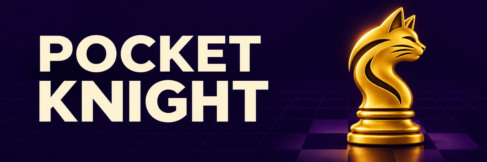
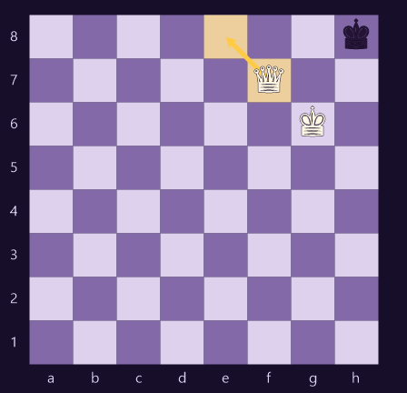

<h1 align="center">
  
</h1>

<p align="center"><strong>A complete chess engine in 4,092 bytes of Python.</strong></p>

<p align="center">
  <a href="https://github.com/amitkumar-bit/pocket-knight"></a>
</p>

<p align="center">
  <a href="#try-it">Try the demo</a> · <a href="engine.py">Read the source</a> · <a href="https://github.com/amitkumar-bit/pocket-knight/tree/makefun-entry">Competition snapshot</a>
</p>

## Mission

Make chess-engine design easier to learn and reproduce. One readable source file lets you trace how a move is generated, scored, and searched. [Competition rules](https://make.fun/bounty/tiny-chess-01)

## Try it

Run the mate-in-one demo with Python 3.13 and its standard library.

```sh
git clone https://github.com/amitkumar-bit/pocket-knight.git
cd pocket-knight
python examples/mate_in_one.py
```

<p align="center">
  <br>
  <code>f7e8</code> · The white queen moves to e8 for checkmate.
</p>

## Official practice result

| Elo | Wins | Spare plies |
| ---: | ---: | ---: |
| 2,112 | 6/6 | 719 |

These scores come from make.fun’s practice grader for the 4,092-byte submission. [Official Pocket Knight result](https://make.fun/api/submissions/01a208e6-7874-7019-9d38-8a6f800a35ff)

## Inside the engine

- A 0x88 board supports legal move generation, including castling, en passant, and all four promotions.
- Iterative-deepening negamax uses principal-variation search, a transposition table, and quiescence search.
- Incremental tapered evaluation scores material, piece placement, king cover, and pawn structure.
- Fixed node budgets make move selection reproducible.

## Rebuild the competition entry

`engine.py` is the readable source for the packed `main.py`. The `makefun-entry` tag pins the exact submitted commit. With the competition kit downloaded, run its compressor from the repository root.

```sh
node path/to/tiny-chess-01-kit/cli/makefun.mjs compress engine.py --out rebuilt.py
```

The competition entrypoint plays through make.fun’s HTTP referee at `MAKEFUN_ENV_URL`. The local demo calls the same engine directly. [Python entrypoint](main.py) · [MIT license](LICENSE)

## Contribute

Ideas for saving bytes or improving search are welcome. When reporting a move, include the FEN, the move Pocket Knight played, and the outcome you expected. [Open an issue](https://github.com/amitkumar-bit/pocket-knight/issues/new)

[Project icon](assets/pocket-knight-icon.png)
